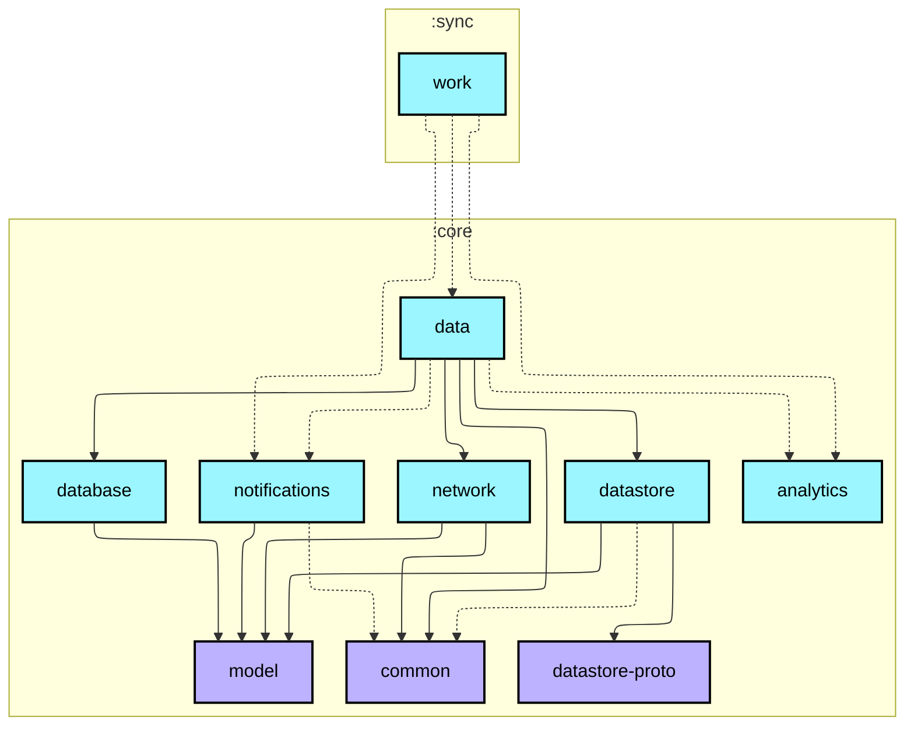
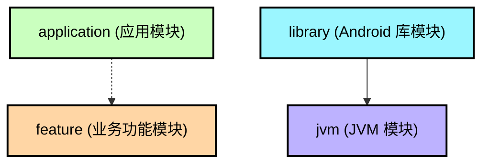

# `:sync:work`

[English](README.md) | [简体中文](README.zh-CN.md)

本模块是 Now in Android 离线优先（Offline-First）数据架构的后台同步实现核心。它基于 Jetpack WorkManager 构建，负责在后台安全、高效地从远程后端同步数据到本地持久化存储（Room / DataStore）。

## 核心架构与设计机制

### 1. WorkManager 调度与约束（Constraints）
* **单例唯一任务（Unique Work）**：在应用启动时（`Sync.initialize(context)`），通过 `enqueueUniqueWork(SYNC_WORK_NAME, ExistingWorkPolicy.KEEP, ...)` 启动。确保全局任何时刻至多只有一个同步任务在运行，避免重复拉取、竞态冲突和电池电量浪费。
* **加急任务（Expedited Work）**：使用 `setExpedited()` 申请快速调度；若在老版本 Android 上作为前台服务执行，会自动弹出低优先级系统通知保证任务存活。
* **网络约束**：设置了 `NetworkType.CONNECTED`，仅在设备有可用网络连接时才执行同步。

### 2. `DelegatingWorker` 解耦设计模式
* **背景与痛点**：在多模块工程中，如果直接使用 Hilt 的 `@HiltWorker`，通常要求主应用（`:app` 模块的 `Application` 类）实现 `Configuration.Provider` 并注入 `HiltWorkerFactory`，从而破坏了库模块的独立性。
* **解决方案**：引入 `DelegatingWorker` 作为无参中间人。WorkManager 首先实例化它；接着它在运行时通过 Dagger Hilt 入口点（`HiltWorkerFactoryEntryPoint`）动态获取 `HiltWorkerFactory`，进而实例化带有完整依赖注入的真实 `SyncWorker`，实现库模块与主工程配置的完全解耦。

### 3. 并行增量同步与全文检索联动
在 `SyncWorker.doWork()` 中：
* **协程并行同步**：通过 `awaitAll(async { topicRepository.sync() }, async { newsRepository.sync() })` 同时拉取话题和新闻数据，最大化网络利用效率。
* **增量版本追踪**：`SyncWorker` 实现了 `Synchronizer` 接口，配合 DataStore 中持久化的 `ChangeListVersions`，每次仅拉取最新版本之后的差异（Delta）数据，极大节省流量。
* **更新本地全文检索**：同步全部成功后，触发 `searchContentsRepository.populateFtsData()` 刷新本地 Room FTS 搜索索引。

### 4. 多变体（Flavors）与静默推送唤醒
* **`demo` 变体**：绑定 `StubSyncSubscriber`（本地空实现），用于无后端依赖的本地预览与开发。
* **`prod` 变体**：
  * `FirebaseSyncSubscriber`：自动向 Firebase Cloud Messaging (FCM) 订阅 `sync` 主题；
  * `SyncNotificationsService`：接收服务端下发的静默数据推送，自动调用 `syncManager.requestSync()` 触发后台静默同步。

### 5. UI 响应式状态感知
* `WorkManagerSyncManager` 实现了 `core:data` 中的 `SyncManager` 接口。
* 将 WorkManager 的 `getWorkInfosForUniqueWorkFlow` 转化为数据流 `isSyncing: Flow<Boolean>`，UI 层（如顶部下拉刷新动画、加载条）直接收集此 Flow 即可实时响应同步进度。

## 模块依赖图

<!--region graph-->

📋 图例说明

<!--endregion-->
