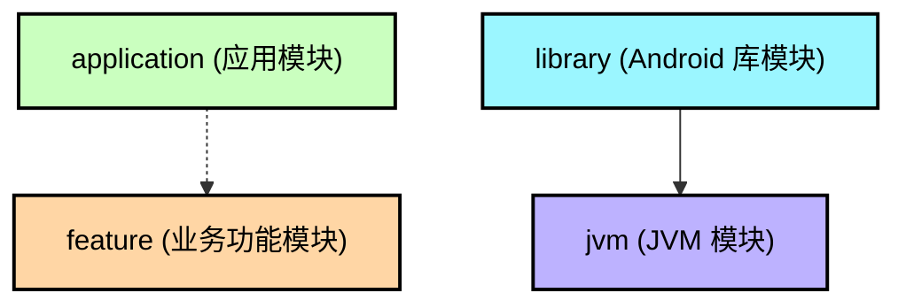

# `:ui-test-hilt-manifest`

[English](README.md) | [简体中文](README.zh-CN.md)

本模块提供了一个标注了 `@AndroidEntryPoint` 并在 `AndroidManifest.xml` 中完成注册的空壳 `HiltComponentActivity`，用于在多模块架构下支持 Jetpack Compose UI 测试与屏幕截图测试（如 Roborazzi）。

## 核心作用与设计背景

1. **测试中的 Hilt 依赖注入**：  
   当测试依赖 Hilt 注入 ViewModel（`@HiltViewModel`）的 Compose 界面或组件时，承载该组件的 Activity 必须带有 `@AndroidEntryPoint` 注解。AndroidX 默认提供的 `ComponentActivity` 没有该注解。

2. **Dagger/Hilt Issue [#3394](https://github.com/google/dagger/issues/3394) 官方 Bug 绕行方案**：  
   在多模块 Gradle 工程中，直接在业务或功能模块的测试源码集中声明带有 `@AndroidEntryPoint` 的测试 Activity，会导致清单文件合并（Manifest Merge）以及类解析冲突。将其抽离至独立的 Library 模块是 Google 官方推荐的最佳实践。

3. **防止测试 Activity 泄露到生产包**：  
   通过在 `:app` 模块中使用 `debugImplementation(projects.uiTestHiltManifest)`，确保测试专用的 Activity 和清单配置仅打包进 Debug / Test 变体中，而绝不会泄露至线上 Release 包。

4. **无标题栏主题（NoActionBar）**：  
   在 `AndroidManifest.xml` 中将 `HiltComponentActivity` 的主题指定为 `@android:style/Theme.Material.Light.NoActionBar`，避免系统默认标题栏遮挡测试视图或干扰 Roborazzi 截图测试比对。

## 使用示例

在 Compose 截图测试或 UI 集成测试中使用：

```kotlin
@get:Rule(order = 1)
val composeTestRule = createAndroidComposeRule<HiltComponentActivity>()
```

## 模块依赖图

```mermaid
---
config:
  layout: elk
  elk:
    nodePlacementStrategy: SIMPLE
---
graph TB
  :ui-test-hilt-manifest[ui-test-hilt-manifest]:::android-library

classDef android-application fill:#CAFFBF,stroke:#000,stroke-width:2px,color:#000;
classDef android-feature fill:#FFD6A5,stroke:#000,stroke-width:2px,color:#000;
classDef android-library fill:#9BF6FF,stroke:#000,stroke-width:2px,color:#000;
classDef android-test fill:#A0C4FF,stroke:#000,stroke-width:2px,color:#000;
classDef jvm-library fill:#BDB2FF,stroke:#000,stroke-width:2px,color:#000;
classDef unknown fill:#FFADAD,stroke:#000,stroke-width:2px,color:#000;
```

<!--region graph-->


<details><summary>📋 图例说明</summary>



</details>
<!--endregion-->
